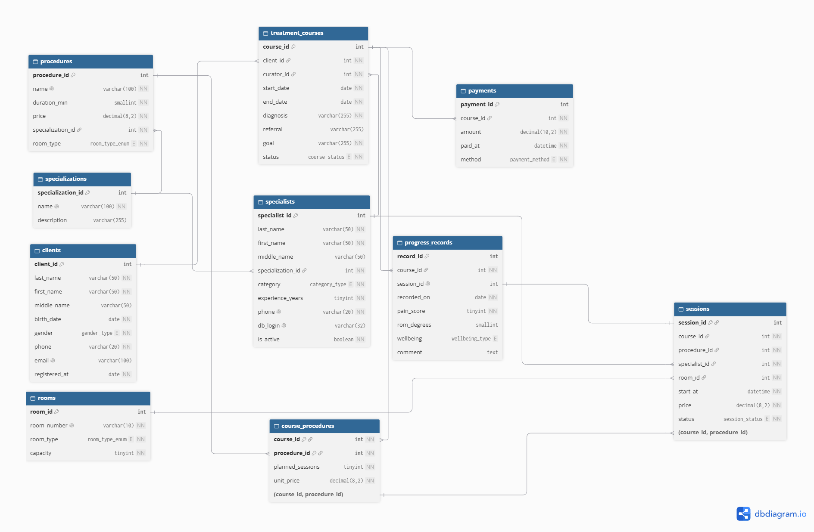
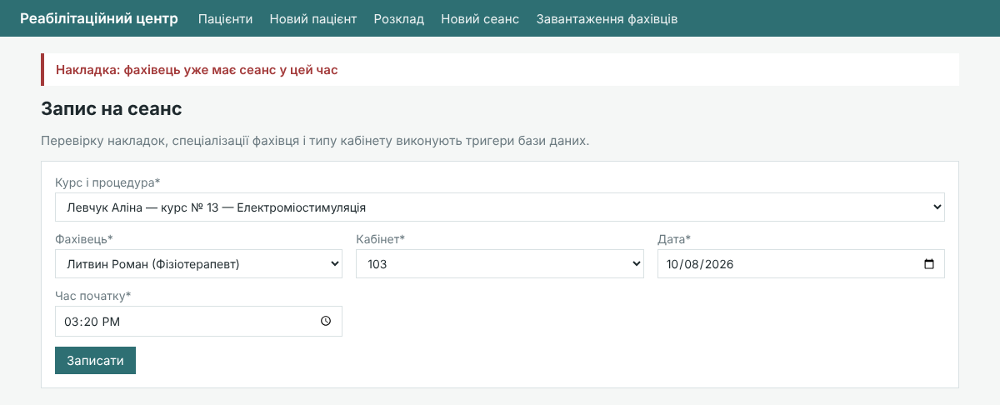
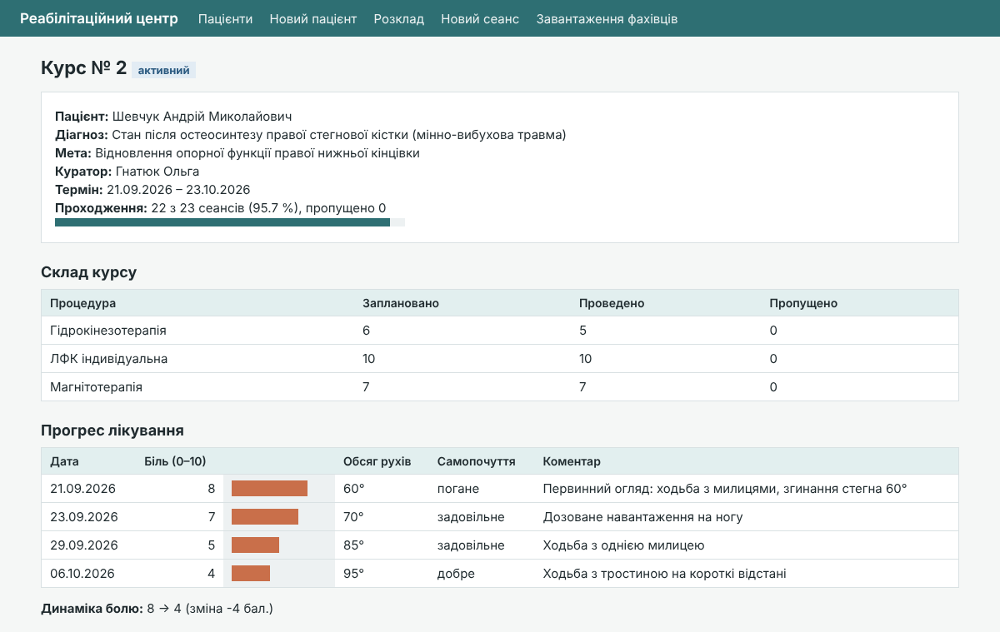
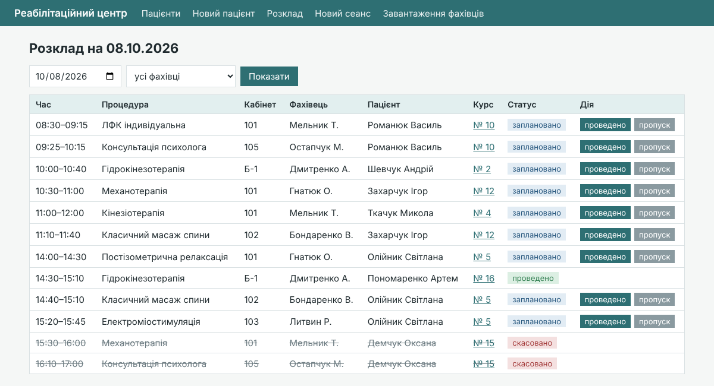
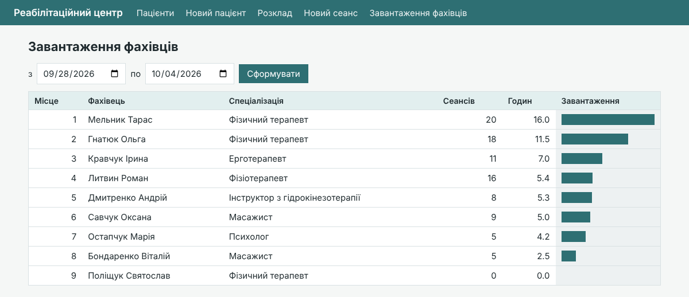
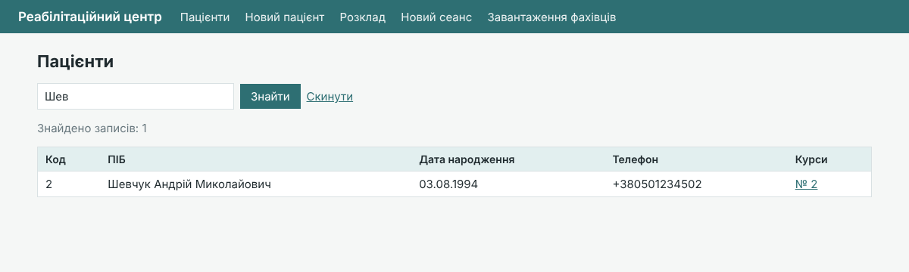
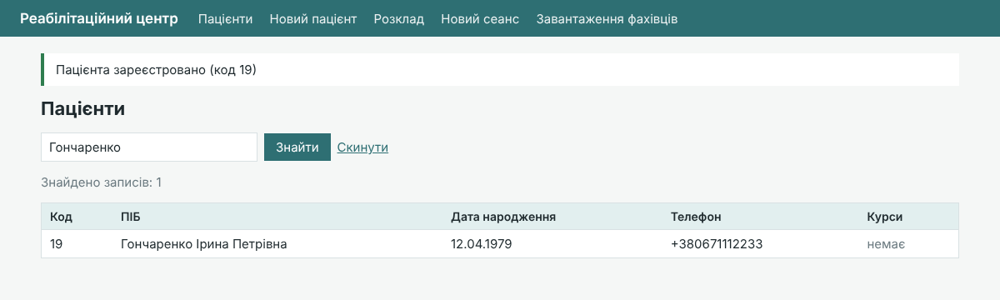

# База даних для реабілітаційного центру

Курсова робота з дисципліни «Бази даних».

| | |
|---|---|
| **Виконав** | Рибонька Єгор Володимирович, група ІПЗ 3/2 |
| **Спеціальність** | 121 «Інженерія програмного забезпечення» |
| **Керівник** | Лагоднюк Данило Олегович |
| **Заклад** | Рівненський фаховий коледж інформаційних технологій |

## Про проєкт

Реляційна база даних MySQL для обліку роботи реабілітаційного центру: пацієнти, фахівці, процедури, кабінети, курси лікування, розклад сеансів, записи прогресу та оплати. Головні правила предметної області перевіряє сама СКБД, незалежно від клієнтського застосунку.

**Склад бази даних:**

1. 10 таблиць у третій нормальній формі, зв'язок M:N між курсами і процедурами через `course_procedures`.
2. 9 тригерів: заборона накладок фахівця, пацієнта і кабінету, контроль плану процедур, запису на неактивний курс, відповідності фахівця і кабінету процедурі, автоматичне завершення курсу.
3. 7 збережених процедур, 4 представлення, 7 додаткових індексів.
4. 3 ролі (адміністратор, фахівець, керівник) і 4 облікові записи; фахівець бачить і змінює лише власні сеанси, реєстратура не має доступу до записів прогресу.
5. 12 SQL-звітів (JOIN, GROUP BY, HAVING, підзапити, віконні функції).
6. Демонстраційний вебінтерфейс на Python і Flask.

Скрипти перевірено на MySQL 8.0.46 і MySQL 9.6.

## ER-діаграма



Код діаграми для [dbdiagram.io](https://dbdiagram.io): [`sql/er_diagram.dbml`](sql/er_diagram.dbml).

## Структура репозиторію

```
sql/
  01_schema.sql      структура БД: таблиці, індекси, тригери, процедури, представлення, ролі
  02_data.sql        тестові дані (персональні дані вигадані)
  03_queries.sql     основні SQL-операції, перевірка тригерів і 12 звітів
  04_roles_test.sql  перевірка прав фахівця (під обліковим записом melnyk)
  er_diagram.dbml    код ER-діаграми
rehab_app/           демонстраційний вебзастосунок (Python, Flask, MySQL Connector/Python)
  app.py             маршрути
  db.py              підключення, запити, обробка помилок СКБД
  config.py          параметри підключення
  templates/         шаблони Jinja2
  static/style.css   стилі
  start.bat          запуск у Windows
docs/                ER-діаграма, схема бізнес-процесу, архітектура застосунку, скріншоти
```

## Запуск

### База даних

1. Відкрити MySQL Workbench під користувачем `root`.
2. Виконати `sql/01_schema.sql`, потім `sql/02_data.sql`.
3. Запити з `sql/03_queries.sql` виконувати по одному (Ctrl+Enter): сценарії перевірки тригерів навмисно завершуються помилками.
4. `sql/04_roles_test.sql` виконувати в новому з'єднанні під обліковим записом `melnyk`.

### Вебінтерфейс

Потрібен Python 3.10 або новіший.

Найпростіше у Windows: двічі клацнути `rehab_app/start.bat`. Файл сам встановить залежності, запропонує вибрати робоче місце (1 - реєстратура, 2 - керівник) і відкриє браузер. Для швидкого запуску є також `start_reception.bat` і `start_director.bat`.

Вручну:

```
cd rehab_app
pip install -r requirements.txt
python app.py
```

Після запуску відкрити http://127.0.0.1:5000.

За замовчуванням застосунок працює від облікового запису `rehab_app` (реєстратура, без доступу до записів прогресу). Робоче місце керівника:

```
set DB_USER=director
set DB_PASSWORD=Dir#2026pass
python app.py
```

Інші змінні середовища: `DB_HOST`, `DB_PORT`, `SECRET_KEY`, `FLASK_DEBUG=1`.

### Облікові записи

| Обліковий запис | Пароль | Роль |
|---|---|---|
| `registrar` | `Reg#2026pass` | адміністратор (реєстратура) |
| `rehab_app` | `App#2026pass` | адміністратор, використовує вебзастосунок |
| `melnyk` | `Mel#2026pass` | фахівець |
| `director` | `Dir#2026pass` | керівник центру |

## Скріншоти

| | |
|---|---|
|  |  |
| Повідомлення тригера при накладці | Картка курсу з прогресом лікування |
|  |  |
| Розклад сеансів на день | Звіт про завантаження фахівців |
|  |  |
| Список пацієнтів із пошуком | Реєстрація пацієнта |
